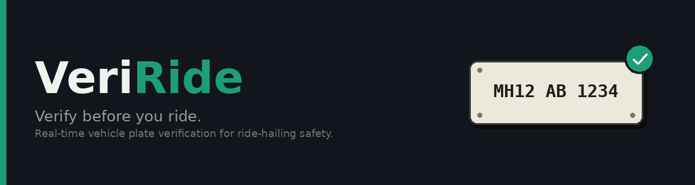
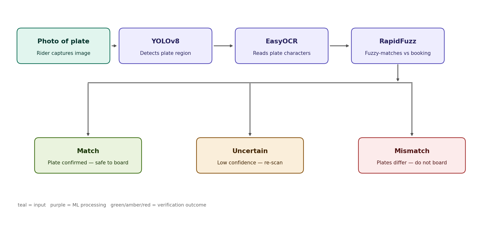

# VeriRide

**Verify before you ride.**

[]()
[]()
[]()

---

You book a ride. The app shows a vehicle number. The auto that pulls up has a
*different* one. You get in anyway — because what else are you supposed to do,
stand there comparing digits at 11pm?

That gap is the problem. **VeriRide closes it** — point your camera at the actual
plate, it reads the number, checks it against what you booked, tells you in
under a second if something's off.

## ⚙️ How it works



```
📸 photo of plate → 🔍 YOLOv8 detects plate → 🔤 EasyOCR reads text
   → 🧮 RapidFuzz matches vs booking → ✅ match / ⚠️ uncertain / 🚫 mismatch
```

## 🧱 Built with

| Layer | Tool |
|---|---|
| Plate detection | YOLOv8 |
| Text extraction | EasyOCR |
| Fuzzy matching | RapidFuzz |
| Backend | Flask + PostgreSQL |
| Frontend | Streamlit |

## 📍 Where this stands

- [x] Architecture + planning
- [ ] 🔬 OCR pipeline — accuracy benchmarking *(currently here)*
- [ ] Flask API + database
- [ ] Fuzzy match engine
- [ ] Streamlit frontend
- [ ] Deployed demo + video walkthrough

## 🔮 Planned (V2)

- [ ] **Driver identity verification** — match the driver's actual photo against
      their registered profile photo at booking time, flagging a mismatch if a
      different person shows up. Same "expected vs actual" pattern as plate
      verification, applied to identity instead of just the vehicle.

## 🎯 Why build this

Vehicle-number mismatches in ride-hailing bookings are a real, reported safety
gap — small enough to ignore, big enough to matter at 11pm alone. This isn't a
toy dataset project; it's an end-to-end CV pipeline (detection → OCR → fuzzy
matching) aimed at an actual problem.

> **Note:** standalone prototype — the "booked plate" is entered manually here
> to simulate what a ride app would provide via its own booking API.

## 🚀 Getting started

```bash
git clone https://github.com/AkankshaD2/veriride.git
cd veriride
pip install -r requirements.txt
```

More setup instructions land here once the backend is up.

---

⭐ if this is useful, and PRs welcome once the MVP lands.
